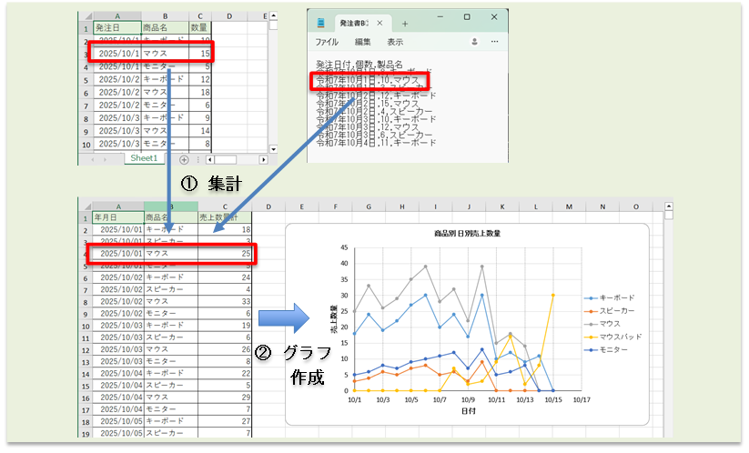

# 売上データ自動集計ツール

Excel・CSV形式の発注書を読み込み、日付・商品別に数量を集計して、Excel形式のレポートを作成するPythonツールです。

異なる形式の発注書に対応し、商品別の数量推移をグラフ化するとともに、入力データの不備を検出する機能を備えています。



## 主な機能

- **データ集計**：Excel・CSV形式の発注書を読み込み、日付・商品別に数量を集計
- **レポート出力**：集計結果をExcelファイルに出力
- **グラフ作成**：商品別の数量推移をグラフ化
- **入力チェック**：必須列の不足、日付・数量の不正、空データなどを検出
- **複数ファイルへの対応**：ファイル名と拡張子のルールに基づいて対象の発注書を認識

## 入力チェックの検証

入力データの不備による誤処理を防ぐため、ファイル名とデータ形式の不一致、必要列の不足、数量の不正など、複数の条件で動作を検証しました。

以下に、検証したケースと期待する処理を示します。

| No. | テストケース | 入力条件 | 期待する処理 |
|---:|---|---|---|
| 01 | 拡張子の不一致 | ファイル名と拡張子の組み合わせが不正 | エラーを通知し、処理を中止 |
| 02 | A形式のファイル名にB形式の内容 | A形式の名前・拡張子だが、内部構造がB形式のExcelファイル | エラーを通知し、処理を中止 |
| 03 | B形式のファイル名にA形式の内容 | B形式の名前・拡張子だが、内部構造がA形式のCSVファイル | エラーを通知し、処理を中止 |
| 04 | 必要列の不足 | 発注書に必要な列が含まれていない | エラーを通知し、処理を中止 |
| 05 | データが空 | ヘッダーのみで、データ行が存在しない | エラーを通知し、処理を中止 |
| 06 | 数量が数値文字列 | 数量が `"10"` や `"5"` などの文字列 | 数値に変換できる場合は処理を継続 |
| 07 | 数量が変換できない文字列 | 数量が `"10個"` や `"abc"` など、数値に変換できない文字列 | エラーを通知し、処理を中止 |
| 08 | データ途中の空行 | データの途中に完全な空行がある | エラーを通知し、処理を中止 |
| 09 | 発注書が存在しない | 対象となる発注書ファイルがない | エラーを通知し、処理を中止 |

## 使用技術

- Python 3.9.12
- pandas
- openpyxl
- PyInstaller
- Git

## フォルダ構成

```text
sales_report_automation/
├── src/
│   └── main.py
├── input/
│   ├── 発注書A①.xlsx
│   ├── 発注書A②.xlsx
│   ├── 発注書A③.xlsx
│   ├── 発注書B①.csv
│   ├── 発注書B②.csv
│   └── 製品別売上レポート.xlsx
├── output/
├── tests/
│   └── test_data/
│       ├── 発注書A③.xlsx
│       ├── 発注書A_途中空行.xlsx
│       ├── 発注書A_数量変換不可.xlsx
│       ├── 発注書A_数量文字列.xlsx
│       ├── 発注書A_列不足.xlsx
│       ├── 発注書A.csv
│       ├── 発注書A_データ空.xlsx
│       └── 発注書B④.csv
├── README.md
└── .gitignore
```

※ `製品別売上レポート.xlsx` はレポート出力用のテンプレートです。上記は主要なファイルを示した構成例です。

※tests/test_data/ には、入力エラーの動作確認に使用するテストファイルを格納しています。

## 実行方法

### 1. 実行環境

Python 3.9.12と、以下のライブラリが必要です。

- pandas
- openpyxl

### 2. 入力ファイルの準備

`input/` フォルダに、集計対象の発注書とレポートテンプレートを配置します。

発注書は、次のファイル名・拡張子のルールで認識されます。

| 形式      | 認識条件                            | サンプルファイル                               |
| ------- | ------------------------------- | -------------------------------------- |
| Excel形式 | ファイル名が `発注書A` で始まり、拡張子が `.xlsx` | `発注書A①.xlsx`、`発注書A②.xlsx`、`発注書A③.xlsx` |
| CSV形式   | ファイル名が `発注書B` で始まり、拡張子が `.csv`  | `発注書B①.csv`、`発注書B②.csv`                |

対象外のファイルやフォルダは無視します。入力データに問題がある場合は、エラーを通知して処理を中断します。

リポジトリに含まれるサンプルデータを使用して、動作を確認できます。

### 3. ライブラリのインストール

必要なライブラリが未インストールの場合、ターミナルで次のコマンドを実行します。

```bash
python -m pip install pandas openpyxl
```

### 4. プログラムの実行

プロジェクトのルートフォルダ `sales_report_automation/` から、次のコマンドを実行します。

```bash
python src/main.py
```

### 5. 出力結果

集計結果は `output/` フォルダに、`製品別売上レポート.xlsx` として出力されます。

## 実行ファイル（exe）のビルド

PyInstallerを使用して、Windows向けの実行ファイルを作成できます。

PyInstallerが未インストールの場合は、次のコマンドでインストールします。

```bash
python -m pip install pyinstaller
```

プロジェクトのルートフォルダから、次のコマンドを実行します。

```bash
pyinstaller --onedir src/main.py
```

ビルド後の実行ファイルは、通常 `dist/main/` フォルダ内に生成されます。

### exeの実行準備

ビルドした `main.exe` を実行する場合は、`dist/main/` フォルダ内に `input/` と `output/` フォルダを配置します。

`input/` には発注書とテンプレートファイルを、`output/` はレポートの出力先として用意してください。

```text
dist/
└── main/
    ├── main.exe
    ├── input/
    │   ├── 発注書A①.xlsx
    │   ├── 発注書B①.csv
    │   └── 製品別売上レポート.xlsx
    └── output/
```

※ 上記は配置例です。発注書は必要に応じて複数配置できます。

## 開発で工夫した点

- **データ処理**：異なる形式の発注書を共通の形式に整理して集計する処理を実装しました。
- **要件確認・調整**：依頼者の意図や目的を確認するロールプレイを通じて、レポートやグラフの構成・表示方法を検討・調整しました。
- **入力チェック**：必須列の不足やデータ形式の不正などを検出し、問題の原因を確認しやすいようにエラー通知を実装しました。
- **AIの活用**：実装方針の検討、コードの理解・修正、エラー調査、グラフの調整案やテストケースの検討に活用。提案内容を確認し、動作検証を行いながら開発しました。

## 開発期間

2026年8月26日〜2026年10月8日
